<div align="center">

<!-- Animated Typing Header -->
<a href="https://github.com/dhruv-lx">
  
</a>

<p align="center">
  <b>Crafting clean code, breaking complex problems, and building modern web applications.</b>
</p>

<!-- Social & Status Badges -->
<p align="center">
  <a href="https://github.com/dhruv-lx?tab=repositories"></a>
  <a href="mailto:your-email@example.com"></a>
  <a href="https://linkedin.com"></a>
  <a href="https://github.com/dhruv-lx"></a>
</p>

---

</div>

## 👨‍💻 About Me

```yaml
Name: Dhruv
Role: Full Stack Developer & Tech Enthusiast
Passions: Web Architecture, AI Integration, Scalable Backends, Clean UI/UX
Current_Focus: Advanced System Design, Full-Stack TypeScript & AI-Powered Tools
Motto: "Turn coffee and ideas into scalable software."
```

- 🔭 **What I'm building**: Autonomous tools, web applications, and AI integrations (like [Red-Guard](https://github.com/dhruv-lx/Red-Guard)).
- 🌱 **What I'm learning**: Distributed systems, microservices, and high-performance server runtimes.
- 👯 **Collaboration**: Open to collaborating on open-source projects, modern web tools, and full-stack products.
- 💬 **Ask me about**: JavaScript, TypeScript, React, Node.js, Express, REST APIs, Git workflows.
- ⚡ **Fun fact**: When code doesn't work, I stare at it until it gets intimidated and fixes itself.

---

## 🐍 GitHub Contribution Snake

<!-- Interactive Animated Contribution Snake eating DHRUV -->
<div align="center">
  
</div>

---

## 💻 Tech Stack & Skills

<div align="center">

### Frontend & UI
<a href="https://skillicons.dev">
  
</a>

<br />

### Backend & Databases
<a href="https://skillicons.dev">
  
</a>

<br />

### Tools & DevOps
<a href="https://skillicons.dev">
  
</a>

</div>

---

## 🔥 Featured Projects

<table>
  <tr>
    <td width="50%" valign="top">
      <h3 align="center">🛡️ Red-Guard</h3>
      <p align="center">
        <b>Autonomous Reddit Moderation Copilot & Threat Radar</b>
      </p>
      <ul>
        <li>Built for the Reddit Mod Tools Hackathon with Devvit 2.0 Webview.</li>
        <li>DeepSeek-V3 LLM semantic analysis for toxicity and harassment triage.</li>
        <li>1-click enforcement terminal (Warn, Remove, Mute, Ban) and live radar.</li>
      </ul>
      <p align="center">
        <a href="https://github.com/dhruv-lx/Red-Guard"><b>Explore Red-Guard →</b></a>
      </p>
    </td>
    <td width="50%" valign="top">
      <h3 align="center">🌿 Dayflow HRMS</h3>
      <p align="center">
        <b>Next-Gen Human Resource Management & Operations Platform</b>
      </p>
      <ul>
        <li>Full-stack workplace suite: Employee Directory, 1-Click Clock-In, and Paystubs.</li>
        <li>Dual-layer security: Firebase Authentication + Local JWT & bcrypt.</li>
        <li>Built with React 18, Express API, Prisma ORM, and custom Dark Mode UI.</li>
      </ul>
      <p align="center">
        <a href="https://github.com/adityapritam/Dayflow"><b>Explore Dayflow →</b></a>
      </p>
    </td>
  </tr>
</table>

---

## 📊 GitHub Analytics & Streak

<div align="center">

<table border="0">
  <tr>
    <td>
      <a href="https://github.com/dhruv-lx">
        
      </a>
    </td>
    <td>
      <a href="https://github.com/dhruv-lx">
        
      </a>
    </td>
  </tr>
  <tr>
    <td colspan="2" align="center">
      <a href="https://github.com/dhruv-lx">
        
      </a>
    </td>
  </tr>
</table>

</div>

---

## 🌐 Connect With Me

<div align="center">

<a href="https://github.com/dhruv-lx">
  
</a>
&nbsp;
<a href="https://linkedin.com">
  
</a>
&nbsp;
<a href="mailto:your-email@example.com">
  
</a>
&nbsp;
<a href="https://twitter.com">
  
</a>

<br /><br />

<!-- Random Dev Quote Generator -->


<br /><br />

<p align="center">
  <i>⭐️ Thanks for stopping by my GitHub profile! Feel free to star my repos and connect!</i>
</p>

</div>
